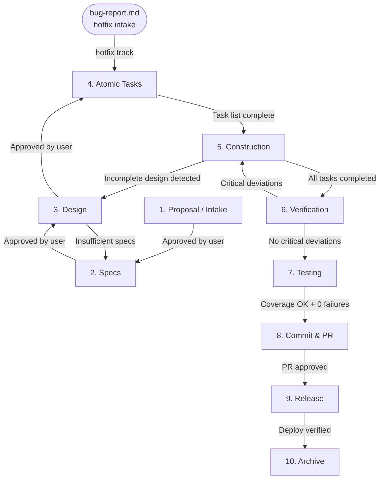

# Phase Transitions

Defines when and how to advance from one phase to the next.

---

## Track Entry Points

| Track            | Entry Phase         | Phases skipped   |
| ---------------- | ------------------- | ---------------- |
| `new-feature`    | Phase 1             | None             |
| `change-request` | Phase 1 (CR intake) | Phase 3 optional |
| `hotfix`         | **Phase 4**         | Phases 1, 2, 3   |

> See `framework/config/phase-skips.yml → tracks` and `AGENTS.md → Track Selection`.

> Canonical source: framework/config/phase-skips.yml → tracks (operational summary: AGENTS.md).

---

## Flow Diagram



---

## Universal Transition Blockers

These blockers apply to every phase transition, including track-specific skips and rollback paths.

- Unresolved open questions: do not transition if the current phase artifact contains any question with status `open`.
- Invalid deferral: do not transition if a deferred question lacks explicit user approval or a named target phase.
- Future artifact created: do not transition if the agent persisted an artifact owned by a later phase during the current phase. Remove or reclassify it only with user confirmation.
- Premature state update: do not update `active.yml.current_phase` until quality gates pass and required approval is recorded.
- Missing structured prompt: do not transition until the agent has asked the user a structured next-step question and received approval when required.
- Missing full-path reporting: do not transition until produced artifacts are identified with full repo-relative paths.
- Epic-map freshness: do not transition a child (type: feature with parent_epic) if its epic-map.yml row disagrees with its active.yml phase/status — update the row in the same session (child active.yml wins).

Required closeout prompt format (replace the example values with the current phase, artifact, and QG IDs):

    [PHASE number: phase name] closeout
    Produced: full repo-relative artifact path(s)
    Open questions: none
    Quality gates: Passed: current phase passed QG IDs, Pending: current phase pending QG IDs
    Next options:
    1. Approve and proceed to the next phase
    2. Request changes in the current phase
    3. Resolve open questions before proceeding
    4. Pause here

Do not replace this structured prompt with a bare "Do you approve?" question.

---

## Transition Rules

### 1 → 2: Proposal / Intake to Specs

- **Condition**: The intake artifact has been read, discussed, and explicitly approved.
- **Approval owner**: User.
- **Axet action**: Read the intake artifact (`proposal.md` or `cr-intake.md`) and use it as input to generate specs.
- **Hotfix track**: This transition does not apply — hotfix enters at Phase 4.

### 2 → 3: Specs to Design

- **Condition**:
  - Specs meet the baseline Phase 2 Quality Gates (`framework/rules/quality-gates.md`).
  - Any **technology-specific** Phase 2 Quality Gates are satisfied, if present (e.g., `technology-rules/[technology]/quality-gates.md`).
- **Approval owner**: User.
- **Axet action**: Present specs summary + quality gate result (baseline + technology-specific when applicable), then read `02-specs/specs.md` and generate the architecture design only after approval.

### 3 → 4: Design to Atomic Tasks

- **Condition**:
  - Design approved. All components are defined.
  - All **baseline** Phase 3 Quality Gates are satisfied (`framework/rules/quality-gates.md`).
  - Any **technology-specific** Phase 3 Quality Gates are satisfied, if present (e.g., `technology-rules/[technology]/quality-gates.md`).
- **Approval owner**: User.
- **Axet action**: Present design summary + quality gate result (baseline + technology-specific when applicable), then decompose each design component into numbered atomic tasks only after approval.

### 4 → 5: Tasks to Construction

- **Condition**:
  - Task list complete and reviewed. Dependencies are ordered.
  - All **baseline** Phase 4 Quality Gates are satisfied (`framework/rules/quality-gates.md`).
  - Any **technology-specific** Phase 4 Quality Gates are satisfied, if present (e.g., `technology-rules/[technology]/quality-gates.md`).
- **Approval owner**: User.
- **Axet action**: Present task summary + quality gate result (baseline + technology-specific when applicable), then load technology rules and execute tasks in dependency order only after approval.

### 5 → 6: Construction to Verification

- **Condition**:
  - All tasks in the task-list marked as `[x]`.
  - All **baseline** Phase 5 Quality Gates are satisfied (`framework/rules/quality-gates.md`).
  - All **technology-specific** Phase 5 Quality Gates are satisfied, if present (e.g., `technology-rules/[technology]/quality-gates.md`).
- **Approval owner**: User (Axet presents a completion summary and waits for explicit approval).
- **Axet action**: Present build summary + quality gate result (baseline + technology-specific) and block transition if any gate/evidence is missing.

### 6 → 7: Verification to Testing

- **Condition**:
  - Verification report with no critical deviations. Minor deviations documented.
  - All **baseline** Phase 6 Quality Gates are satisfied (`framework/rules/quality-gates.md`).
  - All **technology-specific** Phase 6 Quality Gates are satisfied, if present (e.g., `technology-rules/[technology]/quality-gates.md`).
- **Approval owner**: User.
- **Axet action**: Present verification summary + quality gate result (baseline + technology-specific) and block transition if any gate/evidence is missing. If static analysis requirements are not met, enforce rollback to Phase 5.

### 6 → 5: Verification detects issues (Rollback)

- **Condition**: Critical deviations are detected during verification.
- **Action**: Document deviations in the verification report, return to phase 5 to fix.

### 7 → 8: Testing to Commit & PR

- **Condition**: Coverage meets the threshold defined in the applicable technology rules, 0 failing tests.
- **Approval owner**: User (Axet presents test results summary and waits for explicit approval).
- **Axet action**: Present test results + coverage metrics, ask user to confirm before preparing commit and PR.

### 8 → 9: Commit & PR to Release

- **Condition**: PR approved by reviewer.
- **Approval owner**: External reviewer + User.
- **Axet action**: Generate release notes and execute deployment process.

### 9 → 10: Release to Archive

- **Condition**: Deploy verified in target environment. Functionality confirmed.
- **Approval owner**: User.
- **Axet action**: Generate retrospective and mark project as ARCHIVED.

---

## Allowed Rollbacks

| From    | To      | Reason                                         |
| ------- | ------- | ---------------------------------------------- |
| Phase 3 | Phase 2 | Insufficient or incorrect specs                |
| Phase 5 | Phase 3 | Incomplete design detected during construction |
| Phase 6 | Phase 5 | Critical deviations detected                   |
| Phase 7 | Phase 5 | Critical bugs found during testing             |

Any rollback must be documented in the current phase's artifact before rolling back.

---

## Rejection Protocol

When a user rejects a phase artifact (responds "no", "not approved", or provides corrective feedback), the agent must follow this protocol:

### Step 1 — Acknowledge the rejection

Post a structured rejection notice:

```
[PHASE X: NAME] — Rejected ✗
Reason: <summarise the user's feedback in 1–3 sentences>
```

### Step 2 — Determine the rollback target

1. Check `framework/config/phase-approval.yml` for the `rejection_action` of the current transition.
2. If `return_to_current` → stay in the same phase, incorporate feedback, regenerate the artifact.
3. If `return_to_phase_N` → announce the rollback, update the current artifact with a rejection note, then restart phase N.

### Step 3 — Document the rejection

Before regenerating or rolling back, append a rejection entry to the current phase artifact:

```markdown
## Rejection Record

- Date: {{date}}
- Rejected by: User
- Reason: {{reason}}
- Action taken: {{return_to_current | return_to_phase_N}}
```

### Step 4 — Re-present for approval

After incorporating feedback and regenerating the artifact, re-trigger the approval flow:

- Post the updated summary + quality gate result, using full repo-relative artifact paths.
- Re-ask with explicit next-step options from the closeout prompt format instead of a bare yes/no question.

### Rules

- ❌ Never silently absorb feedback and advance to the next phase.
- ❌ Never regenerate without first acknowledging the rejection reason.
- ✅ Always confirm with the user that the revision addresses the original concern before advancing.
