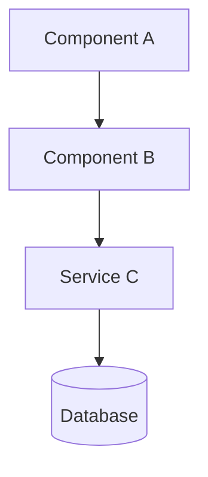
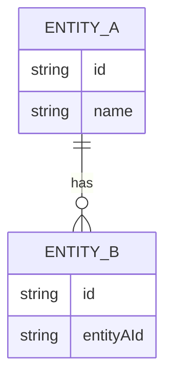

# Skill: Architecture Design

**Phase**: 3 — Design
**Input**: `02-specs/specs.md`
**Output**: `03-design/design.md`

---

## Process

1. Read all specs (`02-specs/specs.md`)
2. Identify the system's functional domains
3. Define the components of each domain
4. Design the data model
5. Define data flows between components
6. Identify external integrations and their contracts
7. Document architecture decisions (ADRs)
8. Run a technology feasibility validation before closing Phase 3
9. Run an ADR gap scan and decide which closed technical decisions need ADRs vs explicit deferment
10. Execute a data-model self-consistency check
11. Generate diagrams in Mermaid
12. Validate that the design covers 100% of FRs and NFRs and that traceability is explicit
12b. If this item is an epic child, confirm its wave and depends_on against work-item/[parent-epic]/epic-map.yml and the stack waves table before freezing component boundaries.

---

## Design Principles

### Separation of concerns

- Each component has **a single responsibility**
- Components do not know the implementation details of other components
- Dependencies flow in a single direction (never circular)

### Typical application layers

- **Presentation**: UI, visual components, views
- **Application**: use case orchestration, controllers
- **Domain**: business logic, entities, rules
- **Infrastructure**: persistence, external integrations, APIs

### Configuration over code

- Extract configurable values to configuration files or environment variables
- Avoid hardcoded values in code

### Fail fast

- Validate inputs as early as possible
- Errors must propagate with clear and actionable messages

---

## Design Document Structure

### 1. Overview

Description of the solution in 2-3 paragraphs. What problem it solves and how.

### 2. Component Diagram



### 3. Data Model



### 4. Data Flows

Description of the main flows (happy path + edge cases):

- **Flow 1**: [name] → step-by-step of how data flows
- **Flow 2**: [name] → ...

### 5. Components

For each component define:

```markdown
#### [ComponentName]

- **Type**: class / module / service / API / UI / etc.
- **Responsibility**: [the single thing it does]
- **Inputs**: [what it receives]
- **Outputs**: [what it produces or returns]
- **Dependencies**: [other components it uses]
```

### 6. External Integrations

For each integration:

```markdown
#### [External system name]

- **Type**: REST API / GraphQL / Database / Message / Webhook / etc.
- **Direction**: inbound (receives) / outbound (sends) / bidirectional
- **Authentication**: [mechanism]
- **Contract**: [endpoint, payload, schema]
- **Error handling**: [what to do if it fails]
```

### 7. ADRs — Architecture Decision Records

```markdown
#### ADR-001: [Decision title]

- **Context**: Why this decision needs to be made
- **Decision**: What is decided
- **Alternatives considered**: What other options were evaluated and why they were discarded
- **Consequences**: Positive and negative impact of the decision
```

### 8. Technology feasibility validation

Before closing Phase 3, validate every material technology assumption in the design against real platform constraints for the target stack.

This validation is mandatory for decisions that affect:
- metadata capabilities and limits
- audit/history feasibility
- storage model feasibility
- lifecycle implementation feasibility
- validation/enforcement feasibility
- import/export feasibility

Rules:
- do not assume a platform capability without checking whether the underlying technology actually supports it
- when the design relies on metadata/history/storage behavior, explicitly confirm feasibility in the design or ADR rationale
- if the platform cannot support the desired behavior natively, the design must document the compensating pattern or record the deviation explicitly
- see `technology-rules/[technology]/rules.md` Phase 03 for the per-stack minimum checklist
  (e.g. Salesforce: history-tracking trackable types; Dynamics: column types eligible for audit/history)

### 9. ADR gap scan

Before closing Phase 3, review `design.md` for closed technical decisions that materially affect:
- architecture/component boundaries
- validation ownership
- traceability or auditability
- security or enforcement model
- metadata shape or data model
- lifecycle behavior
- import/export behavior
- user interaction guardrails

The ADR gap scan must also produce an explicit **Spec vs Design deviations** register:
- list every source-spec requirement that the design leaves as deferred, optional, conditional, or rejected
- do not leave spec/design deviations implicit
- for each deviation, record whether it is accepted, rejected, or pending human sign-off
- if the source spec requires something and the design does not freeze it, that gap must be explicitly recorded before Phase 3 can close

For each significant decision:
- create an ADR if the decision is non-obvious, high impact, or likely to affect later build/test choices
- otherwise record the decision explicitly in the design decision status matrix with rationale
- do not leave significant decisions half-closed and undocumented

### 10. Data-model self-consistency check

Before closing Phase 3, execute a self-consistency review of the proposed data model and metadata usage.

At minimum, verify:
- field descriptions do not reference nonexistent API names
- picklist values and field descriptions are mutually consistent
- flags such as External ID, requiredness, uniqueness, and track history are coherent with how the field is used in flows, imports, lookups, and lifecycle rules
- integration keys and lookup-driving keys have an explicit decision on uniqueness/indexing strategy
- metadata usage described in the design matches the actual field/object definitions being referenced

Any inconsistency must be corrected in the design or listed explicitly as an open issue/blocker.

### 11. Traceability requirements

The design must explicitly connect:
- FRs / NFRs from `02-specs/specs.md`
- any important DF or source inputs referenced by the work item
- design sections / components / flows / data model elements
- ADRs where a requirement forces a non-trivial technical choice

Traceability must make it easy to answer:
- which requirement forced this design choice?
- where in the design is it implemented?
- was the choice frozen in an ADR or left deferred?

### 12. Decision status matrix

The design should contain a matrix distinguishing:
- **Closed** decisions: frozen in Phase 3
- **Deferred** decisions: intentionally postponed, with rationale and next phase/owner if applicable

A deferred decision is acceptable only when the design explicitly says why it is not being frozen yet.

---

## Complete Design Checklist

- [ ] All FRs from phase 2 have at least one component that implements them
- [ ] All NFRs are covered in the design
- [ ] No components have multiple responsibilities
- [ ] The data model covers all necessary data
- [ ] Integrations have defined contracts
- [ ] ADRs justify non-obvious decisions
- [ ] Technology feasibility validation has been completed
- [ ] No unsupported platform capability has been assumed
- [ ] An ADR gap scan has been completed
- [ ] An explicit Spec vs Design deviations register exists for any deferred/optional/rejected source-spec requirement
- [ ] Data-model self-consistency check has been completed
- [ ] No field descriptions reference nonexistent API names
- [ ] Picklist values/descriptions and key metadata flags are coherent with intended usage
- [ ] Traceability from FR/NFR/DF inputs to design sections/components/ADRs is explicit
- [ ] Closed vs deferred decisions are clearly separated
- [ ] The user has reviewed and approved
