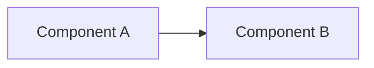

# Design — {{project_name}}

## 1. Goals & Scope

- Goals:
- Out of scope:

## 2. Architecture Overview

### Component diagram (Mermaid)

## 3. Components

> For each component: responsibility, inputs/outputs, dependencies, data, errors, scaling.

### CMP-01 — {{component_name}}

- Responsibility:
- Inputs:
- Outputs:
- Dependencies:
- Key decisions:
- Failure modes / error handling:

## 4. Data Model

- Entities / aggregates:
- Fields / attributes:
- Relationships:
- Ownership / access-control implications (if applicable — see technology rules):

## 5. Integrations

- Integration points:
- Auth:
- Retry / timeouts:
- Observability/logging:

## 6. Security & Compliance

- Authorization & data-access strategy (see technology rules for platform specifics):
- Threats / mitigations:
- Audit requirements:

## 7. ADRs (Architecture Decision Records)

- ADR-0001 — {{title}} — Status: Proposed/Accepted/Superseded

### ADR gap scan

- Closed technical decisions identified in `design.md`:
- Decisions promoted to ADRs:
- Significant decisions intentionally left without ADR:
- Rationale for each deferred/non-ADR decision:

## 8. Traceability

### Requirements → Design → ADR traceability

| Requirement / source | Design section(s) | Component(s) / flow(s) | ADR(s) / decision reference |
| --- | --- | --- | --- |
| FR-000 / NFR-000 / DF section | Section X | CMP-01 | ADR-0001 |

- Map FR/NFR/DF input → Components (CMP-\*):

## 9. Decision status matrix

| Decision ID | Decision summary | Status (Closed / Deferred) | Captured in design section | ADR reference | Rationale / next step |
| --- | --- | --- | --- | --- | --- |
| DEC-000 | Example decision | Closed | Section X | ADR-0001 | Replace with real content |

## 10. Open Questions

> Phase 3 cannot close while any question has status `open`. Deferred questions require explicit user approval and a target phase.

| ID | Question | Status | Resolution | Owner | Target phase |
| --- | --- | --- | --- | --- | --- |
| Q-000 | No open questions at draft creation. Add real questions as needed. | cancelled | Not applicable | Agent | Phase 3 |

## 11. Sizing & Split Decision

- Metrics: CMP=__, integrations=__, domains=__
- Sizing gates triggered: QG__ / none
- Decision: monolith | epic-split
- If epic-split → proposed epic slug + slicing strategy (domain | risk | tech-layer) + estimated children:
- Justification / override (required if continuing as monolith with gates triggered):

## 12. Approval

- **Status**: Draft / Approved
- **Approved by**:
- **Date**:
