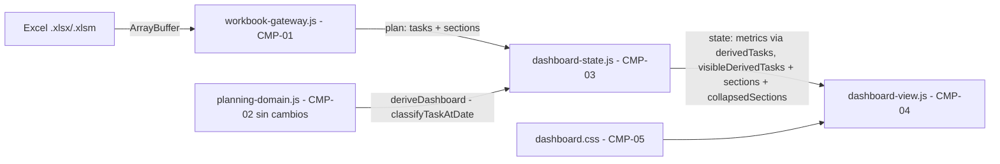

# Design — CR-004: Secciones colapsables en el Gantt

## 1. Goals & Scope

- **Goals**: Extender el pipeline de lectura y renderizado del cuadro de mando para que las filas de sección del Excel sean detectadas, modeladas y representadas como cabeceras colapsables en el Gantt, sin alterar los KPIs ni las reglas de clasificación de tareas.
- **Out of scope**: persistencia del estado de colapso, secciones anidadas, exportación de secciones, impacto en KPIs.

---

## 2. Architecture Overview



Las capas del sistema (technology-rules/web-standalone Phase 03) se mantienen: configuración → carga de fuente → parsing/normalización → reglas de dominio → estado/filtrado → presentación.

---

## 3. Components

### CMP-01 — workbook-gateway.js (extensión)

- **Responsibility**: Detectar filas de sección, construir objetos de sección e incluirlos en el plan junto a las tareas. Asignar a cada tarea el `sectionId` de la sección que la precede.
- **Inputs**: Hoja de cálculo Excel (ArrayBuffer), descriptor de hoja.
- **Outputs**: Objeto plan con `tasks[]`, `sections[]` (nuevo) y demás campos existentes sin cambios.
- **Key decisions**:
  - Una fila es sección si: `name` no vacío AND `assignee` en blanco AND `durationDays` en blanco AND `plannedStart` en blanco AND `plannedEnd` en blanco.
  - Las secciones no pasan por `validateTaskValues`; no generan quality issues.
  - `taskFromRow` se mantiene sin cambios; la detección de sección ocurre en `createProjectPlan` antes de llamar a `taskFromRow`.
  - Cada tarea recibe el campo `sectionId: string | null` con el id de la sección más reciente que la precede, o `null` si no hay ninguna.
  - El id de sección sigue el patrón `"${descriptor.id}:${sourceRow}"`.
- **Nueva función pura**: `sectionFromRow(row, descriptor, sourceRow) → { id, name, sourceRow }`.
- **Failure modes**: Una fila con nombre y algunas fechas pero no todas se trata como tarea normal y pasa por validación; no es error de gateway.

### CMP-02 — planning-domain.js (sin cambios)

- **Responsibility**: Reglas puras de dominio: `classifyTaskAtDate`, `deriveDashboard`, `normalizeDateOnly`. No conoce secciones.
- **Key decisions**: `deriveDashboard` opera exclusivamente sobre `tasks[]`; las secciones nunca le son pasadas. Los KPIs se garantizan inalterados por diseño.

### CMP-03 — dashboard-state.js (extensión)

- **Responsibility**: Gestionar el estado global incluyendo la lista de secciones y el conjunto de secciones colapsadas. Derivar `visibleDerivedTasks` separado de `derivedTasks` para separar la base de métricas de la vista.
- **Nuevos campos de estado**:
  - `sections: Object.freeze([])` — array de objetos `{ id, name, sourceRow }` del plan actual.
  - `collapsedSections: Object.freeze([])` — array de IDs de sección colapsadas (en memoria).
  - `visibleDerivedTasks: Object.freeze([])` — `derivedTasks` filtrado para excluir tareas cuyo `sectionId` está en `collapsedSections`.
- **Nuevo action**: `SECTION_TOGGLED { sectionId }` — alterna la presencia de `sectionId` en `collapsedSections` y recalcula `visibleDerivedTasks`.
- **Reset de colapso**: `WORKBOOK_LOADED` y `PROJECT_SELECTED` reinician `sections`, `collapsedSections` y `visibleDerivedTasks`.
- **Invariante**: `metrics` siempre se calcula a partir de `derivedTasks` completo, nunca de `visibleDerivedTasks`.
- **Función helper**: `computeVisibleDerivedTasks(derivedTasks, collapsedSections)` — filtra de forma pura.

### CMP-04 — dashboard-view.js (extensión)

- **Responsibility**: Renderizar cabeceras de sección en el panel de tareas (HTML) y en el área temporal (SVG), gestionar el control de colapso/expansión.
- **Cambios en `renderGantt`**:
  - Recibe `state.visibleDerivedTasks` (en lugar de `state.derivedTasks`) para el layout y el panel de tareas.
  - `computeGanttLayout` recibe una lista de entradas ordenadas `entries[]` (secciones + tareas visibles, ordenadas por `sourceRow`) en lugar de solo tareas.
  - Para cada entrada de tipo sección: el row SVG es una banda sombreada de ancho total (`x=0`, `width=layout.width`), sin barra de progreso.
  - Para cada entrada de tipo tarea: comportamiento actual sin cambios.
- **Panel de tareas HTML** (izquierda):
  - Las filas de sección se renderizan como `<div class="gantt-section-header">` con un `<button aria-expanded="true|false" aria-controls="...">` para el toggle.
  - Las filas de tarea se renderizan como hasta ahora.
  - El botón de toggle despacha `SECTION_TOGGLED { sectionId }` al store.
- **Accesibilidad**:
  - El botón tiene `aria-expanded` sincronizado con el estado de colapso.
  - El conjunto de filas de la sección tiene `id` referenciado por `aria-controls`.
  - El nombre de la sección es el texto accesible del botón (`aria-label` o texto visible).
- **`computeGanttLayout` (extensión)**:
  - Recibe `entries: [{kind: "section"|"task", data}]` en lugar de `tasks`.
  - Asigna `y = HEADER_HEIGHT + index * ROW_HEIGHT` a cada entrada.
  - Para secciones: `row = { kind: "section", data, x: 0, y, width: null (calculado al renderizar), height: ROW_HEIGHT }`.
  - Para tareas: mismo cálculo actual.
  - El `height` total del SVG se calcula sobre el total de entradas visibles.

### CMP-05 — dashboard.css (extensión)

- **Responsibility**: Estilos visuales para cabeceras de sección y el control de colapso.
- **Nuevas clases**:
  - `.gantt-section-header` — fila del panel izquierdo para sección: fondo sombreado, texto más pequeño, peso de fuente mayor.
  - `.gantt-section-toggle` — botón de colapso/expansión: icono de chevron rotado según `aria-expanded`.
  - `.gantt-section-band` — banda SVG de sección: `fill` con color de fondo sombreado, ancho total.
  - `.gantt-section-label` — texto SVG del nombre de sección dentro de la banda.

---

## 4. Data Model

### Entidad Section (nueva)

```
{
  id: string,         // "${sheetId}:${sourceRow}"
  name: string,       // nombre de la fila de sección en el Excel
  sourceRow: number   // número de fila (1-indexed) en la hoja
}
```

### Extensión de Task (existente)

```
{
  ...campos actuales...,
  sectionId: string | null   // id de la sección que precede a esta tarea; null si no hay sección
}
```

### Extensión de ProjectPlan (objeto retornado por createProjectPlan)

```
{
  ...campos actuales...,
  sections: Section[]   // array ordenado por sourceRow
}
```

### Extensión de State (dashboard-state)

```
{
  ...campos actuales...,
  sections: Section[],
  collapsedSections: string[],     // IDs de secciones colapsadas
  visibleDerivedTasks: Task[]      // derivedTasks sin las tareas de secciones colapsadas
}
```

---

## 5. Integrations

- Sin nuevas integraciones externas. El flujo interno Excel → gateway → state → view no cambia de frontera.

---

## 6. Security & Compliance

- El nombre de la sección se extrae del Excel con `textValue()` (ya existente) y se renderiza con `textContent` (API segura). No se usa `innerHTML`. Cumple la regla de "workbook-derived content never as innerHTML" (technology-rules/web-standalone Forbidden Patterns).
- Sin nuevos requisitos de auditoría.

---

## 7. ADRs

### ADR-0001 — Separación de `derivedTasks` y `visibleDerivedTasks` en el estado — Status: Accepted

**Context**: Los KPIs deben calcularse sobre todas las tareas filtradas por los controles de fecha/asignado/completitud, independientemente del estado de colapso de secciones. El Gantt solo debe mostrar las tareas visibles (no colapsadas).

**Decision**: Mantener `derivedTasks` como base exclusiva de métricas (sin cambios en `deriveDashboard`). Añadir `visibleDerivedTasks` como proyección de `derivedTasks` después de aplicar el filtro de colapso. `renderGantt` usa `visibleDerivedTasks`; los KPIs usan `metrics` (derivado de `derivedTasks`).

**Consequences**: Los KPIs son inmunes al estado de colapso. Se añade una dependencia de `visibleDerivedTasks` al ciclo de reducción de estado (`recalculate` + `SECTION_TOGGLED`).

**Rejected alternatives**: Calcular métricas en la vista a partir de `visibleDerivedTasks` — rechazado porque acopla la lógica de presentación con las reglas de negocio y viola la separación de capas.

---

### ADR gap scan

- Decisiones técnicas cerradas identificadas en `design.md`:
  - DEC-001: criterio de detección de sección (CMP-01).
  - DEC-002: separación derivedTasks / visibleDerivedTasks (CMP-03, ADR-0001).
  - DEC-003: control de colapso en panel HTML, no en SVG (CMP-04).
  - DEC-004: el id de sección sigue el patrón existente de id de tarea.
- Decisiones promovidas a ADR: DEC-002 (ADR-0001) — mayor impacto arquitectónico.
- Decisiones sin ADR: DEC-001, DEC-003, DEC-004 — son consecuencias directas de las specs y las technology rules (no requieren registro formal adicional).

---

## 8. Traceability

| Requirement | Design section | Component(s) | ADR |
| --- | --- | --- | --- |
| FR-01 — Detección de secciones | §3 CMP-01 | workbook-gateway.js | — |
| FR-02 — Modelo de sección en el plan | §3 CMP-01, §4 Data Model | workbook-gateway.js | — |
| FR-03 — Visualización en el Gantt | §3 CMP-04, CMP-05 | dashboard-view.js, dashboard.css | — |
| FR-04 — Control de colapso/expansión | §3 CMP-03, CMP-04 | dashboard-state.js, dashboard-view.js | ADR-0001 |
| FR-05 — KPIs inalterados | §3 CMP-02, CMP-03 | planning-domain.js, dashboard-state.js | ADR-0001 |
| FR-06 — Accesibilidad | §3 CMP-04, CMP-05 | dashboard-view.js, dashboard.css | — |
| NFR-02 — Mantenibilidad | §3 CMP-01, CMP-02 | workbook-gateway.js, planning-domain.js | — |
| NFR-03 — Accesibilidad WCAG AA | §3 CMP-04 | dashboard-view.js | — |

---

## 9. Decision status matrix

| Decision ID | Summary | Status | Design section | ADR | Rationale |
| --- | --- | --- | --- | --- | --- |
| DEC-001 | Criterio de sección: name + sin asignado + sin duración + sin fechas | Closed | §3 CMP-01 | — | Confirmado en FR-01 y Q-001 de Phase 1 |
| DEC-002 | Dos arrays de tareas en estado: derivedTasks (métricas) y visibleDerivedTasks (vista) | Closed | §3 CMP-03 | ADR-0001 | Garantiza KPIs inmunes al colapso |
| DEC-003 | Control de colapso en panel HTML izquierdo, no en SVG | Closed | §3 CMP-04 | — | Requerido por technology-rules (keyboard semantics, focus behavior) y FR-06 |
| DEC-004 | Id de sección: mismo patrón que id de tarea | Closed | §4 Data Model | — | Consistencia interna; evita colisiones de id |

---

## 10. Open Questions

| ID | Question | Status | Resolution | Owner | Target phase |
| --- | --- | --- | --- | --- | --- |
| Q-001 | ¿Qué ocurre con una sección cuya cabecera es visible pero todas sus tareas están filtradas por completitud? | closed | La cabecera de sección se oculta si ninguna de sus tareas pasa el filtro activo (resuelto en specs §8 Q-001). `computeVisibleDerivedTasks` aplica la misma regla: si una sección no tiene tareas visibles en `derivedTasks`, no aparece en la lista de entradas. | Agente | Phase 3 |

---

## 11. Sizing & Split Decision

- Metrics: CMP=5 (2 extensiones significativas, 1 sin cambios, 2 menores), integrations=0 externas, domains=2 (lectura + presentación)
- Sizing gates triggered: none
- Decision: monolith
- Justification: Todos los cambios están en el mismo módulo de código y tecnología, con bajo riesgo de regresión dado que planning-domain.js no se modifica y el estado de colapso está aislado en un nuevo campo.

---

## 12. Approval

- **Status**: Draft
- **Approved by**: —
- **Date**: —
