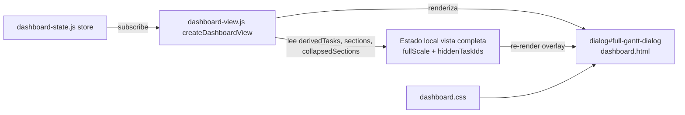

# Design — CR-005: Gantt Vista Completa Expandida

## 1. Goals & Scope

- **Goals**: Introducir un overlay modal de pantalla completa para el Gantt, con escala propia (Día/Mes/Año) y ocultación de tareas a demanda, reutilizando las funciones de layout existentes y gestionando el estado del overlay de forma local sin contaminar el store global.
- **Out of scope**: persistencia de estado, exportación, edición de datos, impacto en KPIs.

---

## 2. Architecture Overview



El store global no se modifica. El estado de la vista completa (`fullScale`, `hiddenTaskIds`) vive como variables de closure dentro de `createDashboardView`.

---

## 3. Components

### CMP-01 — dashboard.html (extensión)

- **Responsibility**: Declarar el elemento `<dialog id="full-gantt-dialog">` con su estructura interna (cabecera con título + botón cierre + selector escala; panel izquierdo de tareas; área SVG).
- **Key decisions**:
  - Usar `<dialog>` nativo para focus trap, gestión de Escape y `role="dialog"` / `aria-modal="true"` automáticos.
  - El interior del `<dialog>` sigue la misma estructura columnar que el Gantt normal: panel izquierdo (`.full-gantt-task-pane`) + área SVG (`.full-gantt-timeline-pane`).
  - Botón "Vista completa" añadido a `.gantt-toolbar` con `id="full-gantt-open-button"`.

### CMP-02 — dashboard-view.js (extensión)

- **Responsibility**: Gestionar el ciclo de vida del overlay (abrir/cerrar, render, estado local) y renderizar el Gantt de vista completa reutilizando `buildGanttEntries` y `computeGanttLayout`.
- **Estado local (closure variables)**:
  - `let fullGanttScale = "month"` — escala propia, default "Mes".
  - `let hiddenTaskIds = new Set()` — IDs de tareas ocultas en la vista completa.
- **Funciones nuevas**:
  - `openFullGantt()` — reinicia `hiddenTaskIds`, establece `fullGanttScale = "month"`, abre el dialog, mueve foco al botón de cierre.
  - `closeFullGantt()` — cierra el dialog, devuelve foco al botón de apertura.
  - `renderFullGantt(state)` — llama a `buildGanttEntries` + `computeGanttLayout` con `fullGanttScale`, aplica filtro de `hiddenTaskIds`, renderiza la lista HTML y el SVG dentro del dialog.
- **Integración**:
  - `renderFullGantt(state)` se llama desde `render(state)` solo cuando el dialog está abierto (`dialog.open`).
  - Los botones de escala del dialog despachan cambios a `fullGanttScale` y llaman a `renderFullGantt`.
  - El toggle de ocultación de tarea actualiza `hiddenTaskIds` y llama a `renderFullGantt`.
- **`scalePixels` extension**: añadir `year: 1` (1 px/día) para la escala anual.

### CMP-03 — dashboard.css (extensión)

- **Responsibility**: Estilos para el dialog de vista completa.
- **Nuevas clases**:
  - `#full-gantt-dialog` — dimensiones 100vw × 100vh, `padding: 0`, `max-width: 100vw`, `max-height: 100vh`, `overflow: hidden`.
  - `#full-gantt-dialog::backdrop` — fondo oscuro semitransparente.
  - `.full-gantt-header` — barra superior: título, selector de escala y botón de cierre.
  - `.full-gantt-shell` — grid 2 columnas (panel tareas + área SVG), altura `calc(100vh - header)`.
  - `.full-gantt-task-pane` — columna izquierda; igual que `.gantt-task-pane`.
  - `.full-gantt-timeline-pane` — columna derecha scrollable.
  - `.full-gantt-hide-toggle` — botón/checkbox de ocultación por tarea; alineado a la izquierda de cada fila.

### CMP-04 — No cambios en dashboard-state.js

- El store global no se modifica. El estado de la vista completa es exclusivamente local al componente de vista.

---

## 4. Data Model

### Estado local de la vista completa (closure en `createDashboardView`)

```
fullGanttScale: "day" | "month" | "year"   // default "month"
hiddenTaskIds: Set<string>                   // task.id de tareas ocultas en la vista completa
```

### Flujo de datos para el render de vista completa

```
store.getState()
  .visibleDerivedTasks   → filtrar hiddenTaskIds → fullVisibleTasks
  .sections              → buildGanttEntries(sections, fullVisibleTasks, derivedTasks, collapsedSections)
  .collapsedSections
  .derivedTasks
                         → computeGanttLayout(entries, { scale: fullGanttScale })
                         → renderizar dialog SVG + task list
```

---

## 5. Integrations

- Sin nuevas integraciones externas. El store se suscribe una vez; `renderFullGantt` se llama desde `render` cuando el dialog está abierto.

---

## 6. Security & Compliance

- Los nombres de tarea se renderizan con `textContent`. Sin uso de `innerHTML`. Sin cambios en la postura de seguridad.
- El foco queda atrapado dentro del `<dialog>` nativo mientras está abierto (comportamiento nativo de `HTMLDialogElement.showModal()`).

---

## 7. ADRs

### ADR-0001 — Estado local en closure vs. estado en el store — Status: Accepted

**Context**: La vista completa necesita escala propia y un set de tareas ocultas. Estas propiedades no deben afectar los KPIs ni el Gantt normal.

**Decision**: Gestionar `fullGanttScale` y `hiddenTaskIds` como variables de closure dentro de `createDashboardView`. El store global no se toca. `renderFullGantt` se invoca desde `render(state)` cuando el dialog está abierto, con acceso a las variables de closure.

**Consequences**: El estado de la vista completa no es serializable ni persistente, lo cual es el comportamiento deseado (se reinicia al cerrar). Los KPIs están 100% aislados.

**Rejected alternatives**: Añadir `fullGanttScale` y `hiddenTaskIds` al store → rechazado porque contaminaría el estado global y exigiría cuidado extra para que `deriveDashboard` no los use.

### ADR-0002 — Uso de `<dialog>` nativo — Status: Accepted

**Context**: El overlay necesita focus trap, gestión de Escape y semántica ARIA de diálogo modal.

**Decision**: Usar el elemento `<dialog>` nativo con `showModal()` / `close()`. Proporciona focus trap, `aria-modal`, Escape-to-close y gestión de backdrop de forma nativa, sin necesidad de librerías.

**Consequences**: Requiere el polyfill de `dialog` para browsers muy antiguos; dado que el proyecto ya usa `htmldialogpolyfill` implícitamente (task-dialog ya usa `<dialog>`), el riesgo es mínimo.

### ADR gap scan

- DEC-001: estado local (ADR-0001) — promovido.
- DEC-002: `<dialog>` nativo (ADR-0002) — promovido.
- DEC-003: `scalePixels("year") = 1 px/día` — no requiere ADR (extensión trivial de la tabla de escala).
- DEC-004: `renderFullGantt` solo se llama cuando `dialog.open === true` — consecuencia directa del diseño lazy; no requiere ADR.

---

## 8. Traceability

| Requirement | Design section | Component(s) | ADR |
|---|---|---|---|
| FR-01 — Botón apertura | §3 CMP-01, CMP-02 | dashboard.html, dashboard-view.js | — |
| FR-02 — Contenido overlay | §3 CMP-02, §4 Data Model | dashboard-view.js | — |
| FR-03 — Escala propia | §3 CMP-02 | dashboard-view.js | ADR-0001 |
| FR-04 — Ocultación de tareas | §3 CMP-02 | dashboard-view.js | ADR-0001 |
| FR-05 — KPIs inalterados | §3 CMP-04, §7 ADR-0001 | dashboard-state.js (sin cambios) | ADR-0001 |
| FR-06 — Accesibilidad | §3 CMP-01, CMP-02 | dashboard.html, dashboard-view.js | ADR-0002 |
| NFR-03 — Mantenibilidad | §3 CMP-02 | dashboard-view.js | — |

---

## 9. Decision status matrix

| Decision ID | Summary | Status | Design section | ADR |
|---|---|---|---|---|
| DEC-001 | Estado local de vista completa en closure, no en store global | Closed | §3 CMP-02 | ADR-0001 |
| DEC-002 | `<dialog>` nativo con `showModal()` para focus trap y Escape | Closed | §3 CMP-01 | ADR-0002 |
| DEC-003 | `scalePixels("year") = 1 px/día` | Closed | §3 CMP-02 | — |
| DEC-004 | `renderFullGantt` solo se ejecuta cuando `dialog.open === true` | Closed | §3 CMP-02 | — |

---

## 10. Open Questions

| ID | Question | Status | Resolution | Owner | Target phase |
|---|---|---|---|---|---|
| Q-001 | No hay preguntas abiertas. | cancelled | Not applicable | Agent | Phase 3 |

---

## 11. Sizing & Split Decision

- Metrics: CMP=4 (1 sin cambios, 3 extensiones), integrations=0 externas, domains=1 (presentación)
- Sizing gates triggered: none
- Decision: monolith

---

## 12. Approval

- **Status**: Draft
- **Approved by**: —
- **Date**: —
