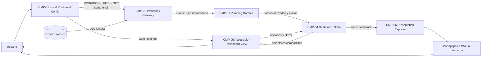
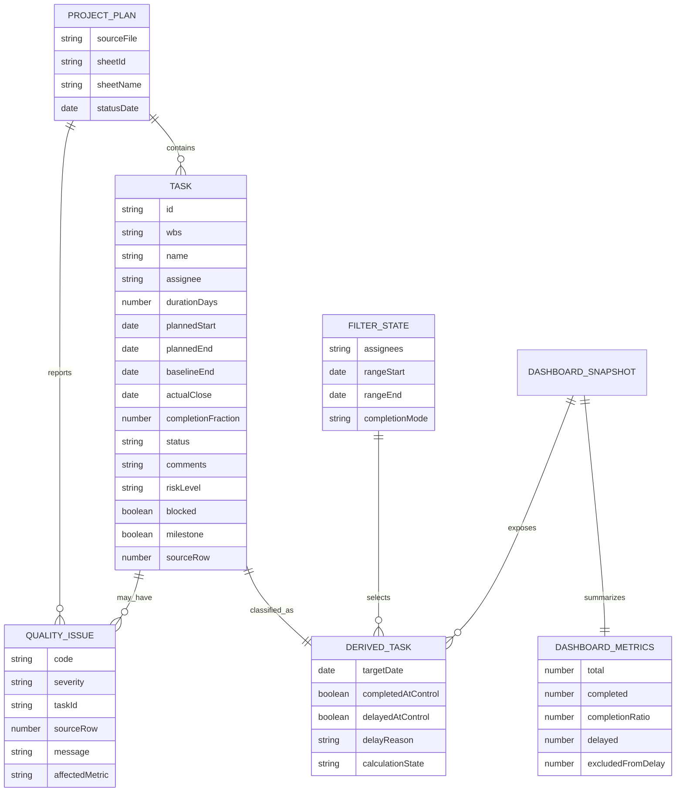

# Design — Cuadro de mando HTML para planificación de proyectos

## 1. Goals & Scope

### Goals

- Entregar `dashboard.html` en el mismo directorio operativo que el Excel y centralizar el nombre del libro en `dashboard-config.js` mediante una única constante `WORKBOOK_FILE`.
- Cargar el libro automáticamente mediante un origen local confiable, sin subir datos ni modificar el fichero.
- Separar por completo la estructura del Excel, las reglas de seguimiento, el estado de filtros y la presentación.
- Representar indicadores y un Gantt accesible que compartan exactamente el mismo conjunto filtrado.
- Generar una imagen 1920×1080 determinista de la vista actual para PowerPoint.

### Out of scope

- Acceso automático desde `file://`, edición del libro, ejecución de macros o recálculo de fórmulas de Excel.
- Persistencia de tareas, filtros, snapshots o historial.
- Backend de aplicación, servicios cloud, telemetría o dependencias de runtime en CDN.
- Generación o modificación de ficheros PowerPoint.

## 2. Architecture Overview

La solución es una aplicación web estática local-first. Un lanzador Windows inicia un servidor HTTP efímero vinculado únicamente a `127.0.0.1`, sirve el directorio del dashboard y abre `dashboard.html`. De esta forma el HTML, sus activos y el Excel configurado comparten origen y el navegador puede obtener el libro por nombre sin selector manual.

El navegador descarga los bytes del libro en modo lectura y SheetJS CE 0.20.3 los convierte en una representación de workbook. El adaptador identifica hojas compatibles por encabezados, normaliza los registros y entrega un modelo sin coordenadas Excel. Las reglas puras derivan completitud, retraso, filtros y métricas. La vista semántica y el Gantt SVG consumen selectores del mismo estado. La exportación compone una instantánea SVG separada, la rasteriza a PNG y usa portapapeles o descarga local como fallback.

### Component diagram (Mermaid)



### Deployment layout

```text
<directorio-del-proyecto>/
├── dashboard.html                 # debe convivir con el Excel
├── dashboard-config.js            # única definición de WORKBOOK_FILE
├── start-dashboard.cmd             # entrada Windows; invoca Node sin PowerShell
├── start-dashboard.mjs             # servidor loopback GET/HEAD, sin escrituras
├── start-dashboard.ps1             # alternativa opcional, no usada por el CMD
├── <libro-configurado>.xlsx|xlsm
└── dashboard-assets/
    ├── dashboard.css
    ├── app.js                      # composition root; sin lógica de negocio
    ├── workbook-gateway.js         # CMP-02
    ├── planning-domain.js          # CMP-03
    ├── dashboard-state.js          # CMP-04
    ├── dashboard-view.js           # CMP-05
    ├── presentation-exporter.js    # CMP-06
    ├── vendor/xlsx-0.20.3.min.js
    └── THIRD_PARTY_NOTICES.txt
```

El build produce la misma forma bajo `dist/html-project-dashboard/`, sin incluir el Excel del usuario. Para usarlo, se copian los ficheros de distribución junto al libro y se ajusta únicamente `WORKBOOK_FILE`.

### 2.1 Mandatory file and module boundaries

- `dashboard.html` contiene exclusivamente estructura semántica y referencias a activos; no incluye bloques `<style>` ni lógica JavaScript inline.
- `dashboard-assets/dashboard.css` contiene todos los estilos propios. Los estilos calculados del Gantt se expresan mediante atributos/variables controladas, no mediante reglas duplicadas en JavaScript.
- `dashboard-config.js` contiene exclusivamente configuración mantenible y es la única autoridad de `WORKBOOK_FILE`.
- `dashboard-assets/app.js` es únicamente el composition root: crea componentes, conecta dependencias y arranca la aplicación. No contiene parsing, reglas, estado, rendering ni exportación.
- Cada componente CMP con lógica JavaScript tiene un módulo primario independiente y no comparte fichero con otro componente: CMP-02 `workbook-gateway.js`, CMP-03 `planning-domain.js`, CMP-04 `dashboard-state.js`, CMP-05 `dashboard-view.js` y CMP-06 `presentation-exporter.js`.
- CMP-01 separa por tecnología: `start-dashboard.cmd` delega en `start-dashboard.mjs`, el módulo Node sirve y `dashboard-config.js` configura. `start-dashboard.ps1` queda como alternativa opcional; el flujo principal no depende de la política de ejecución de PowerShell. No se mezclan responsabilidades de servidor, configuración y UI.
- Un componente puede extraer un helper puro a otro fichero solo cuando el módulo primario superaría 400 líneas de código propio o el helper tenga pruebas/contrato independiente. El helper permanece dentro de la responsabilidad del componente y no puede introducir dependencias inversas.
- Cada módulo expone una API pública mínima mediante exports nombrados, incluye cabecera JSDoc de responsabilidad/entradas/salidas y tiene un fichero de prueba homónimo. Se prohíben imports circulares.
- Los activos de terceros permanecen bajo `dashboard-assets/vendor/`; nunca se mezclan con código propio ni se editan directamente.

| Concern | Production file | Test file / verification |
| --- | --- | --- |
| HTML shell | `dashboard.html` | `tests/e2e/dashboard-shell.spec.js` |
| Styles and responsive/accessibility states | `dashboard-assets/dashboard.css` | Playwright visual/layout and axe checks |
| Configuration | `dashboard-config.js` | `tests/unit/dashboard-config.test.js` |
| Composition | `dashboard-assets/app.js` | `tests/integration/app.test.js` |
| Workbook adapter | `dashboard-assets/workbook-gateway.js` | `tests/unit/workbook-gateway.test.js` |
| Domain calculations | `dashboard-assets/planning-domain.js` | `tests/unit/planning-domain.test.js` |
| State and selectors | `dashboard-assets/dashboard-state.js` | `tests/unit/dashboard-state.test.js` |
| UI and Gantt | `dashboard-assets/dashboard-view.js` | `tests/integration/dashboard-view.test.js` |
| Presentation export | `dashboard-assets/presentation-exporter.js` | `tests/unit/presentation-exporter.test.js` |
| Local server | `start-dashboard.mjs` | `tests/integration/local-server.test.ps1` y smoke E2E |

## 3. Components

### CMP-01 — Local Runtime & Config

- **Technology primitive**: `start-dashboard.cmd`, servidor Node.js `start-dashboard.mjs` basado en `node:http` y módulo ES `dashboard-config.js`; `start-dashboard.ps1` es una alternativa no requerida.
- **Responsibility**: Crear el origen local seguro y publicar la única configuración del nombre del Excel.
- **Inputs**: Directorio de ejecución, `WORKBOOK_FILE`, petición de arranque del usuario.
- **Outputs**: URL `http://127.0.0.1:<puerto>/dashboard.html`, respuestas estáticas GET/HEAD y configuración importable.
- **Dependencies**: Sistema operativo Windows, Node.js 22 o superior y navegador predeterminado; el flujo principal no requiere PowerShell.
- **Key decisions**: Bind exclusivo a `127.0.0.1`; puerto libre elegido en runtime; raíz fijada al directorio del script; sin directory listing; rechazo de rutas que escapen de la raíz; cierre por `Ctrl+C` o 30 minutos de inactividad.
- **Failure modes / error handling**: Puerto no disponible → puerto efímero o error accionable; fichero inexistente → 404 y mensaje de CMP-02; Node ausente → el CMD indica que debe instalarse Node.js 22 o superior; runtime incompatible → error de arranque y requisito de versión documentado; bloqueo de PowerShell no afecta al flujo principal; nunca se usa un fallback inseguro a `file://`.

### CMP-02 — Workbook Gateway

- **Technology primitive**: `fetch`, `ArrayBuffer`, SheetJS CE 0.20.3 vendorizado y módulo independiente `dashboard-assets/workbook-gateway.js`.
- **Responsibility**: Leer bytes, detectar hojas Gantt, validar encabezados y convertir celdas a `ProjectPlan` normalizado.
- **Inputs**: Ruta relativa derivada de `WORKBOOK_FILE` y respuesta binaria del servidor local.
- **Outputs**: `ProjectPlan`, lista de hojas compatibles y `QualityIssue[]`.
- **Dependencies**: CMP-01 y SheetJS CE.
- **Key decisions**: Escanear las primeras 50 filas de cada hoja buscando encabezados normalizados; mapear por nombre/alias, nunca por índice fijo; leer valores guardados; no ejecutar VBA ni fórmulas.
- **Failure modes / error handling**: 404, extensión no admitida, libro corrupto, sin hoja compatible, encabezado duplicado, fórmula sin valor guardado o fecha inválida → issue específico; un error global bloquea métricas, uno de fila excluye solo la clasificación afectada.

### CMP-03 — Planning Domain

- **Technology primitive**: Módulo ES puro independiente `dashboard-assets/planning-domain.js`; helpers puros solo bajo la regla de extracción de §2.1.
- **Responsibility**: Aplicar las definiciones de tarea válida, completada, retrasada, fecha objetivo, solapamiento y agregación.
- **Inputs**: `ProjectPlan`, `controlDate` y `FilterState`.
- **Outputs**: `DerivedTask[]`, `DashboardMetrics` y avisos de cálculo.
- **Dependencies**: Solo tipos normalizados de CMP-02; ninguna dependencia DOM/SheetJS.
- **Key decisions**: Fechas como valores date-only `YYYY-MM-DD`; comparación inclusiva por día local; funciones deterministas sin estado; `baselineEnd ?? plannedEnd` como fecha objetivo.
- **Failure modes / error handling**: Datos insuficientes producen estado `not-calculable` y aviso, nunca cero implícito; total cero produce `completionRatio: null`.

### CMP-04 — Dashboard State

- **Technology primitive**: Módulo ES independiente `dashboard-assets/dashboard-state.js` con store in-memory, acciones y selectores memoizados.
- **Responsibility**: Mantener el estado autorizado de proyecto, fecha, filtros, escala y viewport, y exponer un snapshot coherente a todas las vistas.
- **Inputs**: Eventos de carga, selección de hoja, controles de filtro, fecha y navegación.
- **Outputs**: `DashboardSnapshot` inmutable para CMP-05 y CMP-06.
- **Dependencies**: CMP-03.
- **Key decisions**: Un único pipeline `tasks → filters → derivedTasks → metrics`; no persistencia; actualizaciones atómicas; limpiezas independientes de asignados y fechas; al recargar se conserva la hoja activa si sigue disponible y, en otro caso, se selecciona la primera compatible; la exportación recibe el mismo snapshot visible que la pantalla.
- **Failure modes / error handling**: Acción inválida se rechaza con mensaje; filtros sin coincidencias producen estado vacío explícito; un error de selector no conserva métricas antiguas.

### CMP-05 — Accessible Dashboard View

- **Technology primitive**: `dashboard.html`, `dashboard-assets/dashboard.css` y módulo ES independiente `dashboard-assets/dashboard-view.js`; HTML semántico, controles nativos, tabla/lista DOM y SVG para la línea temporal.
- **Responsibility**: Presentar controles, KPIs, avisos, detalle y Gantt, y convertir interacciones en acciones del store.
- **Inputs**: `DashboardSnapshot` y acciones del usuario.
- **Outputs**: DOM/SVG accesible, eventos de filtro/navegación y solicitud de exportación.
- **Dependencies**: CMP-04.
- **Key decisions**: Lista de tareas y SVG comparten filas de 48 px sincronizadas por `task.id`, sin scroll vertical independiente; `hover` o foco resaltan la fila completa en lista y gráfico. Barras SVG no duplican foco, porque cada fila tiene un botón accesible con los mismos datos. Una única superficie SVG desplazable contiene cuadrícula, barras y cabeceras para impedir líneas fijas superpuestas. La cabecera muestra una banda anual gris oscuro y periodos gris claro: día y semana en `DD/MM`, mes con nombre castellano; la escala diaria reserva al menos 52 px por fecha. La fecha de control es una línea vertical roja discontinua que atraviesa cabecera y filas. Tras carga, filtro o cambio de escala, el viewport se posiciona en la primera tarea; no existe una acción separada «Ajustar a tareas». Las 1.000 filas permanecen alcanzables mediante scroll y teclado.
- **Failure modes / error handling**: Vista vacía con acción “Limpiar filtros”; error global reemplaza KPIs; detalle devuelve el foco al activador; `prefers-reduced-motion` elimina transiciones no esenciales.

### CMP-06 — Presentation Exporter

- **Technology primitive**: Módulo ES independiente `dashboard-assets/presentation-exporter.js`, compositor SVG, `Image`, `CanvasRenderingContext2D`, `canvas.toBlob`, `ClipboardItem` y descarga Blob.
- **Responsibility**: Producir una instantánea 1920×1080 de la ventana visible del snapshot actual.
- **Inputs**: `DashboardSnapshot`, viewport actual, etiquetas y tema de presentación.
- **Outputs**: Blob PNG en portapapeles o fichero `dashboard-YYYY-MM-DD.png`.
- **Dependencies**: CMP-04 y APIs del navegador.
- **Key decisions**: Composición directa a SVG con texto escapado, no captura del DOM; rasterización determinista; portapapeles solo tras gesto de usuario; cualquier rechazo activa descarga PNG.
- **Failure modes / error handling**: API no disponible, permiso denegado o write rechazado → descarga; fallo de rasterización → mensaje sin borrar la vista; URL Blob revocada tras uso.

## 4. Data Model



### 4.1 Workbook mapping contract

El adaptador normaliza mayúsculas, espacios y diacríticos para reconocer alias. Los campos de dominio nunca conocen letras o números de celda.

| Domain attribute | Accepted business header | Required | Validation |
| --- | --- | --- | --- |
| `wbs` | EDT | No | Texto opcional |
| `name` | Tarea | Sí | Texto no vacío; define tarea válida |
| `assignee` | Asignado | No | Vacío se normaliza como “Sin asignar” |
| `durationDays` | Duración / Duracion | No | Número ≥ 0 |
| `plannedStart` | Inicio | Sí | Fecha date-only válida |
| `plannedEnd` | Fin | Sí | Fecha válida y ≥ inicio, salvo hito |
| `completionFraction` | % completado | Sí | 0–1 o 0–100 normalizado a 0–1 |
| `status` | Estado | Sí | Texto actual conservado; valores conocidos se categorizan |
| `comments` | Comentarios | No | Texto sin interpretación HTML |
| `baselineEnd` | Fin línea base / Fin linea base | No | Fecha; fallback a `plannedEnd` |
| `actualClose` | Fecha cierre real | Sí | Fecha opcional; obligatoria para clasificación histórica como completa |
| `riskLevel` | Nivel de riesgo | No | Texto actual |
| `blocked` | Bloqueada | No | Sí/No normalizado a booleano |
| `milestone` | Hito | Sí | Sí/No normalizado a booleano |

Los metadatos `statusDate`, inicio y fin del proyecto se buscan por etiqueta de negocio y valor adyacente dentro de las primeras 20 filas. No se dependen de `B2`, `D2` o `D3`.

### 4.2 Date and formula semantics

- SheetJS convierte seriales Excel considerando el sistema de fechas del workbook; el adaptador serializa el resultado como `YYYY-MM-DD` sin hora ni conversión UTC.
- Valores de fórmula se aceptan solo cuando existe un valor guardado utilizable. Una fórmula sin valor guardado genera `FORMULA_VALUE_MISSING` y el campo se considera ausente.
- `.xlsm` se lee como contenedor; el contenido VBA se ignora y nunca se ejecuta.
- No existe repositorio persistente: toda entidad vive en memoria hasta cerrar o recargar.

## 5. Integrations

### INT-01 — Libro Excel local

- **Type**: HTTP same-origin GET de fichero estático `.xlsx` o `.xlsm`.
- **Direction**: Entrada de solo lectura.
- **Authentication**: Ninguna adicional; acceso limitado por permisos del sistema operativo y servidor loopback.
- **Contract**: `GET /<encodeURIComponent(WORKBOOK_FILE)>` → bytes; tamaño y hash no se alteran. El contenido se adapta mediante la tabla 4.1.
- **Retry / timeouts**: Un reintento manual mediante “Recargar libro”; timeout de 30 segundos; no reintento automático infinito.
- **Error handling**: 404, 403, timeout, formato corrupto o estructura incompatible producen códigos y mensajes distintos.

### INT-02 — Portapapeles y descarga del navegador

- **Type**: Clipboard API para `image/png` y descarga Blob.
- **Direction**: Salida local iniciada por usuario.
- **Authentication**: Permiso/contexto del navegador y activación transitoria.
- **Contract**: Blob PNG 1920×1080; si `ClipboardItem`/`navigator.clipboard.write` falla, se descarga el mismo Blob.
- **Retry / timeouts**: Sin retry automático; el usuario puede repetir.
- **Error handling**: Mensaje accesible anuncia copia, fallback o fallo.

No existen integraciones de red externas. SheetJS y demás activos se sirven localmente.

## 6. Main Data Flows

### FL-01 — Arranque y carga

1. CMP-01 fija la raíz, elige puerto loopback, sirve los activos y abre el navegador.
2. `dashboard.html` importa la única configuración y solicita `WORKBOOK_FILE` por same-origin.
3. CMP-02 verifica respuesta/extensión, lee el `ArrayBuffer`, detecta hojas y crea `ProjectPlan`.
4. CMP-04 selecciona automáticamente la primera hoja compatible; en una recarga conserva la selección anterior si continúa disponible.
5. CMP-03 deriva tareas y métricas; CMP-05 muestra resultados o avisos.

### FL-02 — Fecha y filtros

1. CMP-05 envía una acción con fecha, asignados, intervalo o modo de completitud.
2. CMP-04 valida y aplica la acción de forma atómica.
3. CMP-03 calcula `DerivedTask[]` y métricas sobre la intersección filtrada.
4. CMP-05 actualiza cajas, filas, barras, hitos y línea de control desde el mismo snapshot.

### FL-03 — Navegación accesible del Gantt

1. El foco recorre controles y botones de tarea en orden DOM.
2. Al enfocar/activar una tarea, CMP-05 desplaza su barra al viewport, anuncia sus datos y abre detalle si se solicita.
3. El cambio de escala conserva datos y filtros, recalcula la cabecera y posiciona automáticamente el viewport sobre la primera tarea.
4. La cuadrícula, cabecera, barras, hitos y línea de control se desplazan horizontalmente como una única superficie SVG; no hay scroll vertical independiente entre nombres y barras.

### FL-04 — Exportación

1. Tras un gesto de usuario, CMP-06 recibe el snapshot y viewport visibles.
2. Compone SVG 16:9 con contexto, KPIs, leyenda y filas visibles; lo rasteriza a PNG.
3. Intenta escribir `image/png` al portapapeles.
4. Si no es posible, descarga exactamente el mismo Blob.

## 7. Security & Compliance

- El servidor escucha solo en `127.0.0.1`, admite GET/HEAD, no lista directorios y normaliza cada ruta antes de comprobar que permanece dentro de la raíz.
- Encabezado CSP objetivo: `default-src 'self'; connect-src 'self'; img-src 'self' blob: data:; style-src 'self'; script-src 'self'; object-src 'none'; base-uri 'none'`.
- Todos los valores del workbook se insertan mediante `textContent`, nodos de texto o atributos seguros; no se utiliza `innerHTML` con datos del libro.
- No hay cookies, almacenamiento local, analytics, telemetría ni service worker persistente.
- El release incluye SheetJS CE 0.20.3 y su atribución Apache 2.0 en `THIRD_PARTY_NOTICES.txt`.
- La aplicación no solicita métodos de escritura del sistema de ficheros ni ejecuta VBA.
- Los mensajes evitan exponer rutas absolutas del usuario; muestran solo el nombre configurado y la causa funcional.

## 8. ADRs (Architecture Decision Records)

- ADR-0001 — Loopback local para acceso automático al libro — Status: Accepted
- ADR-0002 — SheetJS CE vendorizado y adaptación por encabezados — Status: Accepted
- ADR-0003 — Modelo de dominio date-only independiente del workbook — Status: Accepted
- ADR-0004 — Gantt accesible con HTML semántico y SVG — Status: Accepted
- ADR-0005 — Exportación determinista SVG a PNG con fallback — Status: Accepted
- ADR-0006 — Separación obligatoria de componentes y activos por fichero — Status: Accepted

### ADR gap scan

- **Closed technical decisions identified**: modelo de ejecución local, parser Excel, contrato de normalización/fechas, estado unidireccional, tecnología de Gantt, seguridad de rendering, exportación y límites físicos de ficheros/módulos.
- **Decisions promoted to ADRs**: ejecución local (ADR-0001), parser/adaptador (ADR-0002), dominio/fechas (ADR-0003), presentación Gantt (ADR-0004), exportación (ADR-0005) y separación mantenible por fichero (ADR-0006).
- **Significant decisions intentionally left without ADR**: el store in-memory y CSP quedan como decisiones cerradas en este diseño porque son consecuencias directas de los ADR y requisitos, no alternativas arquitectónicas independientes.
- **Deferred decisions**: ninguna.

### Spec vs Design deviations

| Requirement | Deviation | Status | Resolution |
| --- | --- | --- | --- |
| FR-01–FR-12, NFR-01–NFR-10 | Ninguna | Accepted | El diseño cubre el requisito completo sin hacerlo opcional ni condicional. |

## 9. Traceability

| Requirement / source | Design section(s) | Component(s) / flow(s) | ADR(s) / decision reference |
| --- | --- | --- | --- |
| FR-01 | §§2, 3 CMP-01 | CMP-01, FL-01 | ADR-0001; `WORKBOOK_FILE` único |
| FR-02 | §§3 CMP-01/02, 5, 7 | CMP-01, CMP-02, INT-01 | ADR-0001, ADR-0002 |
| FR-03 | §§3 CMP-02/04, 4.1 | CMP-02, CMP-04, FL-01 | ADR-0002 |
| FR-04 | §§3 CMP-02/03, 4 | CMP-02, CMP-03 | ADR-0002, ADR-0003 |
| FR-05 | §§3 CMP-03/04/05, 6 | CMP-03, CMP-04, CMP-05, FL-02 | ADR-0003 |
| FR-06 | §§3 CMP-03/04/05, 4 | CMP-03, CMP-04, CMP-05 | ADR-0003 |
| FR-07 | §§3 CMP-03/04/05, 6 | CMP-03, CMP-04, CMP-05, FL-02 | ADR-0003, ADR-0004 |
| FR-08 | §§3 CMP-05, 6 | CMP-05, FL-03 | ADR-0004 |
| FR-09 | §§3 CMP-05, 4, 6 | CMP-05, FL-03 | ADR-0004 |
| FR-10 | §§3 CMP-04/05, 6 | CMP-04, CMP-05, FL-03 | ADR-0004 |
| FR-11 | §§3 CMP-02/03/05, 4 | CMP-02, CMP-03, CMP-05 | ADR-0002–ADR-0004 |
| FR-12 | §§3 CMP-06, 5, 6 | CMP-06, INT-02, FL-04 | ADR-0005 |
| NFR-01 | §§3 CMP-02/03, 11 | CMP-02, CMP-03 | ADR-0002, ADR-0003 |
| NFR-02 | §§3 CMP-03/04/05, 11 | CMP-03, CMP-04, CMP-05 | ADR-0003, ADR-0004 |
| NFR-03 | §§3 CMP-05/06, 6, 7 | CMP-05, CMP-06, FL-03 | ADR-0004, ADR-0005 |
| NFR-04 | §§2, 5, 7 | CMP-01, CMP-02, CMP-06 | ADR-0001, ADR-0002 |
| NFR-05 | §§3 CMP-01/02, 5, 11 | CMP-01, CMP-02 | ADR-0001, ADR-0002 |
| NFR-06 | §§2, 3, 11 | All browser components | ADR-0001–ADR-0005 |
| NFR-07 | §§3 CMP-03/04/05, 6 | CMP-03, CMP-04, CMP-05 | ADR-0003, ADR-0004 |
| NFR-08 | §§2, 2.1, 3 CMP-01 | CMP-01–CMP-06 | ADR-0001, ADR-0006 |
| NFR-09 | §§3 CMP-05/06, 6 | CMP-05, CMP-06, FL-04 | ADR-0004, ADR-0005 |
| NFR-10 | §§2.1, 3 | CMP-01–CMP-06 | ADR-0006 |

## 10. Decision Status Matrix

| Decision ID | Decision summary | Status | Captured in | ADR reference | Rationale / next step |
| --- | --- | --- | --- | --- | --- |
| DEC-01 | Servir en loopback mediante Node.js y no soportar ejecución directa `file://` | Closed | §§2, 3 CMP-01 | ADR-0001 | Cumple carga automática por nombre sin depender de la política de PowerShell |
| DEC-02 | Nombre del libro en `dashboard-config.js` como única autoridad | Closed | §§2, 3 CMP-01 | ADR-0001 | Cumple FR-01/NFR-08 y desacopla launcher |
| DEC-03 | SheetJS CE 0.20.3 vendorizado, sin CDN | Closed | §§3 CMP-02, 7 | ADR-0002 | Soporta XLSX/XLSM y procesamiento browser/offline |
| DEC-04 | Detección por encabezados y modelo sin coordenadas | Closed | §§3 CMP-02, 4 | ADR-0002, ADR-0003 | Tolera posición variable y mantiene reglas testables |
| DEC-05 | Fechas date-only y fórmulas solo con valor guardado | Closed | §§3 CMP-03, 4.2 | ADR-0003 | Evita deriva UTC y falsas reconstrucciones |
| DEC-06 | Store in-memory unidireccional sin persistencia | Closed | §3 CMP-04 | ADR-0003 | Unifica filtros/métricas/Gantt y respeta no histórico |
| DEC-07 | HTML semántico + SVG, sin librería de charts | Closed | §3 CMP-05 | ADR-0004 | Control de accesibilidad, rendimiento y exportación |
| DEC-08 | PNG desde SVG/canvas, clipboard con descarga fallback | Closed | §3 CMP-06 | ADR-0005 | Salida determinista y robusta ante permisos |
| DEC-09 | CSP same-origin y rendering sin `innerHTML` de datos | Closed | §7 | ADR-0002, ADR-0004 | Mitiga contenido Excel no confiable |
| DEC-10 | HTML, CSS, configuración, composición y cada componente en ficheros independientes | Closed | §2.1 y §3 | ADR-0006 | Evita acoplamiento físico, facilita pruebas y mantiene límites de responsabilidad |
| DEC-11 | Cabecera temporal anual/periodos, línea de control y filas alineadas se renderizan en una única superficie SVG | Closed | §3 CMP-05, §6 FL-03 | ADR-0004 | Evita desalineación y artefactos al desplazar, y congela el contrato visual multi-escala |
| DEC-12 | La primera hoja compatible se selecciona automáticamente y la recarga preserva la selección válida | Closed | §3 CMP-04, §6 FL-01 | ADR-0002 | Elimina la inicialización incompleta observada en libros con varias hojas |

## 11. Technology Feasibility & Self-Consistency

### 11.1 Feasibility validation

| Assumption | Result | Evidence / consequence |
| --- | --- | --- |
| Un HTML `file://` puede cargar automáticamente un vecino | Rejected | MDN documenta que los ficheros suelen tener origen opaco y fallan CORS; se requiere localhost. https://developer.mozilla.org/en-US/docs/Web/HTTP/Guides/CORS/Errors/CORSRequestNotHttp |
| Loopback Node permite same-origin y contexto confiable | Validated | `node:http` sirve únicamente `127.0.0.1`; MDN considera loopback un origen potencialmente confiable. https://developer.mozilla.org/en-US/docs/Web/Security/Secure_Contexts. |
| Lectura browser de XLSX/XLSM | Validated | SheetJS CE 0.20.3 admite XLSX/XLSM y `XLSX.read(ArrayBuffer)`. https://docs.sheetjs.com/docs/miscellany/formats/ y https://docs.sheetjs.com/docs/demos/local/file/ |
| Distribución local de SheetJS | Validated | La versión oficial actual 0.20.3 puede vendorizarse; licencia Apache 2.0 exige atribución. https://docs.sheetjs.com/docs/getting-started/installation/standalone/ y https://docs.sheetjs.com/docs/miscellany/license/ |
| Copia PNG y fallback | Validated | Clipboard API admite `image/png` bajo condiciones; `canvas.toBlob` genera PNG ampliamente. https://developer.mozilla.org/en-US/docs/Web/API/Clipboard_API y https://developer.mozilla.org/en-US/docs/Web/API/HTMLCanvasElement/toBlob |
| Accesibilidad objetivo | Validated | Contratos alineados con teclado, contraste, foco y zoom de WCAG 2.2. https://www.w3.org/TR/WCAG22/ |
| Entrega estática local sin red pública | Validated | Prueba efímera 2026-10-23: GET loopback del libro devolvió HTTP 200, 2.665.441 bytes y SHA-256 de respuesta igual al origen (`507924a704d0da47b38fbd8fc3a3eed51a5783f910fa6776f0425cb34de81ad2`). |

Resultado tecnológico: `WSG3.1`, `WSG3.2` y `WSG3.3` satisfechos en diseño; la implementación deberá reproducirlos con el launcher real.

### 11.2 Data-model consistency

- Cada atributo usado por reglas, filtros, Gantt o exportación existe en la entidad `TASK`, `DERIVED_TASK`, `FILTER_STATE` o en el estado efímero de vista (`scale`, `selectedSheetId`).
- Todos los encabezados del libro de referencia están mapeados en §4.1; no hay nombres de campo inexistentes.
- `actualClose` es opcional en origen pero obligatorio para afirmar completitud histórica; la aparente tensión se resuelve como `QualityIssue`.
- `milestone` no se infiere de duración cero: depende únicamente del indicador Hito aprobado en Specs.
- `task.id` se compone de `sheetId + sourceRow`; es único dentro de la carga y estable mientras no cambie la fila. No se usa como clave persistente.
- No existen claves de integración o relaciones persistentes que requieran índices o unicidad externa.

### 11.3 Design consistency checks

| Check ID | Result | Evidence |
| --- | --- | --- |
| B.1 | PASS | Los seis nodos CMP del diagrama tienen inventario completo en §3; Excel, Usuario y Portapapeles son nodos externos/datos. |
| B.2 | PASS | Ningún componente escribe el Excel, conserva históricos, usa cloud o genera PPT; cada CMP tiene un fichero primario independiente conforme a ADR-0006. |
| B.3 | PASS | Los seis títulos del registro coinciden literalmente con sus ficheros ADR. |
| B.4 | N/A | La trazabilidad con el `task-list` histórico se reconciliará únicamente tras aprobar este diseño y reabrir Phase 4, conforme a la regla de fase única. |
| B.5 | PASS | §4.1 define todos los atributos consumidos; ningún módulo de dominio usa coordenadas de hoja. |

## 12. Open Questions

| ID | Question | Status | Resolution | Owner | Target phase |
| --- | --- | --- | --- | --- | --- |
| Q-000 | No hay preguntas abiertas ni decisiones técnicas diferidas. | cancelled | No aplica | Agent | Phase 3 |

## 13. Sizing & Split Decision

- Metrics: CMP=6, integrations=2, domains=2
- Sizing gates triggered: none
- Decision: monolith
- If epic-split → proposed epic slug + slicing strategy + estimated children: No aplica.
- Justification / override: Los seis componentes forman un pipeline local unidireccional y se encuentran dentro del umbral QG3.9.

## 14. Rejection Record

- **Date**: 2026-10-23
- **Rejected by**: User
- **Reason**: El diseño debía garantizar mantenibilidad mediante separación explícita de HTML, estilos, JavaScript y cada componente en ficheros independientes.
- **Action taken**: `return_to_current`; se añadió §2.1, se concretaron los módulos de cada CMP y se creó ADR-0006.

## 15. Approval

- **Status**: Approved — reconciled after Phase 5 documentation rollback
- **Approved by**: User — explicit instruction to continue through end of construction
- **Date**: 2026-10-25
